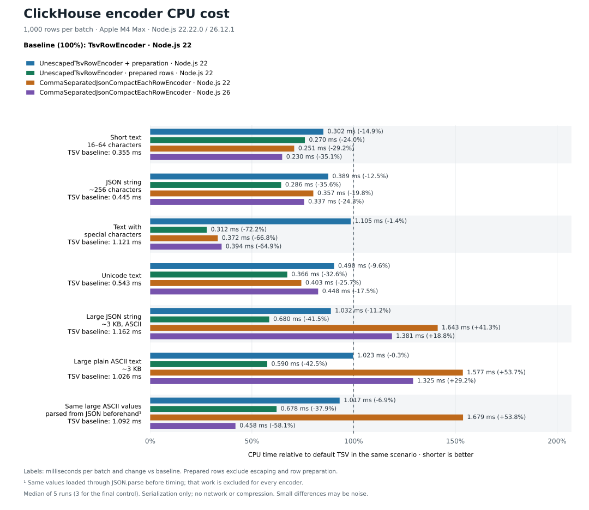

# @bidster/clickhouse-tools

Open-source ClickHouse tools for TypeScript, Node.js, and NestJS applications.
The package contains only infrastructure-level code and intentionally has no
Bidster product-domain models, configuration, environment variable names, or
business rules.

## Installation

```sh
npm install @bidster/clickhouse-tools @clickhouse/client@^1.24.1
```

`@clickhouse/client` is a required peer dependency. NestJS support is optional. Install the Nest peer dependencies only when using
the `/nest` entry point.

## Vanilla TypeScript

```ts
import {
  ClickHouseArrayRowBuffer,
  ClickHouseBatchWriter,
  KeyedSortBuffer,
  rawTsv,
  type ClickHouseRawTsvValue,
} from "@bidster/clickhouse-tools";
import { createClient } from "@clickhouse/client";

type EventRow = {
  id: string;
  created_at: string;
  attributes: ClickHouseRawTsvValue;
};

const client = createClient({
  url: process.env.CLICKHOUSE_URL,
  username: process.env.CLICKHOUSE_USER,
  password: process.env.CLICKHOUSE_PASSWORD,
  database: process.env.CLICKHOUSE_DATABASE,
});

const eventBuffer = new ClickHouseArrayRowBuffer<EventRow>();

const events = new ClickHouseBatchWriter<EventRow>({
  client,
  buffer: eventBuffer,
  insert: {
    table: "events",
    columns: ["id", "created_at", "attributes"],
    clickhouse_settings: {
      insert_deduplicate: 1,
    },
  },
  logger: console,
});

events.open();
eventBuffer.add([
  {
    id: "event-1",
    created_at: "2026-08-11 10:00:00.000",
    attributes: rawTsv("{'source':'api'}"),
  },
]);

await events.close();
await client.close();
```

`buffer` is optional. Without it, the writer creates its own
`ClickHouseArrayRowBuffer`, which stores rows in insertion order. Calling
`writer.write(rows)` delegates to the configured buffer, so an application may
write through either `writer.write(rows)` or a retained buffer instance. A
custom buffer can expose additional insertion methods, but it must implement
the common `size`, `add`, `drain`, and `subscribe` contract. A buffer must have
only one active consumer because `drain()` removes its complete current
contents.

`KeyedSortBuffer` retains complete rows passed to `add()` by reference and returns
those same objects from `drain()`, sorted by the configured keys. Do not mutate
rows, including sorting keys, after adding them and before the writer has finished
sending them. `addKeyed()` retains the tail and materializes a complete row on drain.

`KeyedSortBuffer` groups rows in nested maps by configured sorting columns. An
application can pass complete rows through `writer.write()` or avoid creating a
complete row by passing its sorting-key values and unsorted tail separately:

```ts
const sortedEventBuffer = new KeyedSortBuffer<EventRow, ["id", "created_at"]>({
  keys: ["id", "created_at"],
});

const sortedEvents = new ClickHouseBatchWriter<EventRow>({
  client,
  buffer: sortedEventBuffer,
  insert: {
    table: "events",
    columns: ["id", "created_at", "attributes"],
  },
});

sortedEventBuffer.addKeyed(["event-1", "2026-08-11 10:00:00.000"], {
  attributes: rawTsv("{'source':'api'}"),
});
```

Leaves store complete row references from `add()` and wrapped tails from
`addKeyed()`. `drain()` sorts every key level, returns the complete rows by
reference, and materializes rows only for keyed tails. If sorting or
materialization fails, the buffer retains its rows for another drain attempt.
Rows with equal keys retain their insertion order. The default
ascending comparator supports strings, finite numbers, bigints, and booleans.
Other types require a comparator in the corresponding `comparators` tuple. A
custom comparator is also how an application defines descending or
ClickHouse-specific ordering.

`insert.table` and `insert.columns` form part of the INSERT query and must come
from trusted application configuration, not from user input.
Optional `insert.clickhouse_settings` are passed to every ClickHouse insert
request. They override client-level ClickHouse settings for that request.

`ClickHouseBatchWriter` owns buffering, encoding, retries, and delivery.
Choose an encoder through `rowEncoder`; batching and retry behavior stay the same.

### Choosing an encoder

- **Start with `TsvRowEncoder`.** This is the general-purpose default: it
  automatically escapes strings and works well for most workloads, including
  arbitrary user text. It supports strings, finite numbers, `bigint`, booleans,
  `null`, and `rawTsv` for preformatted ClickHouse values. Choose it when you
  want minimal manual preparation and few special rules for individual fields.

- **Choose `UnescapedTsvRowEncoder` when you control data preparation and want
  to reduce serialization overhead.** UUIDs, formatted dates, and codes can be
  passed directly if their format guarantees no TSV special characters.
  Escape arbitrary text once with `escapeTsvString`. The encoder passes strings
  through without checking for special characters or escaping them again.
  This is especially useful when values are already prepared or serialization
  limits application throughput. If preparation happens immediately before
  writing, include its cost in your comparison. It supports the same scalar
  types as `TsvRowEncoder`, but does not accept `rawTsv` wrappers.

- **Try `CommaSeparatedJsonCompactEachRowEncoder` when you want automatic
  escaping and fast batch serialization.** It uses one `JSON.stringify` for
  the whole batch and supports strings, finite numbers, booleans, and `null`,
  but not `bigint` or `rawTsv`. JSON stored inside a string field stays a
  string. On Node.js 26, plain ASCII text without quotes, backslashes, or
  control characters that require JSON escaping can perform particularly
  well. Results also depend on how strings are created and on batch size;
  ASCII content alone does not guarantee an advantage.

**When choosing for performance, measure the full path you need:** value
preparation, encoding, and delivery. The benchmarks below measure serialization;
overall throughput also depends on compression, the network, and ClickHouse
processing.

| Encoder | What it does | When to choose it |
| --- | --- | --- |
| `TsvRowEncoder` **(default)** | Writes TSV and automatically escapes every string. | General use, especially arbitrary text. No manual string preparation is needed. |
| `UnescapedTsvRowEncoder` | Writes TSV with strings exactly as supplied. | You control the input: most fields are UUIDs, formatted dates, or codes, and only a few text fields need escaping. |
| `CommaSeparatedJsonCompactEachRowEncoder` | Writes `JSONCompactEachRow` using one `JSON.stringify` for the whole batch. | Your rows contain JSON-compatible scalar values and you want automatic escaping with batch-level JSON serialization. |

The default TSV encoder avoids unnecessary replacement work for short strings
that have no special characters. The unescaped encoder skips even that check;
you decide which fields need `escapeTsvString`. The JSON encoder handles string
escaping through JSON serialization and keeps rows comma-separated.

All three accept strings, finite numbers, booleans, and `null`. Both TSV encoders
also accept `bigint`; only the default TSV encoder accepts `rawTsv()` wrappers
for preformatted ClickHouse values. JSON stored in a string stays a string.
Dates, arrays, and other objects must be formatted by the caller. Unsupported
values, including `undefined` and non-finite numbers, throw an error. Empty
batches produce an empty string.

All encoders take an ordered column list. Use the same order in `insert.columns`
and the encoder constructor. Omit `rowEncoder` to use the default.

```ts
import {
  ClickHouseBatchWriter,
  CommaSeparatedJsonCompactEachRowEncoder,
  UnescapedTsvRowEncoder,
  escapeTsvString,
} from "@bidster/clickhouse-tools";

type EventRow = { id: string; created_at: string; type: string; data: string };
const columns = ["id", "created_at", "type", "data"] as const;

// JSON: pass ordinary strings, including arbitrary text.
const jsonEvents = new ClickHouseBatchWriter<EventRow>({
  client,
  insert: { table: "events", columns },
  rowEncoder: new CommaSeparatedJsonCompactEachRowEncoder<EventRow>(columns),
});
jsonEvents.write([
  {
    id: "event-1",
    created_at: "2026-08-11 10:00:00.000",
    type: "session.start",
    data: '{"source":"api"}',
  },
]);
await jsonEvents.close();

// Unescaped TSV: these IDs, dates, and codes need no escaping.
// Prepare the arbitrary text field explicitly.
const tsvEvents = new ClickHouseBatchWriter<EventRow>({
  client,
  insert: { table: "events", columns },
  rowEncoder: new UnescapedTsvRowEncoder<EventRow>(columns),
});
tsvEvents.write([
  {
    id: "event-1",
    created_at: "2026-08-11 10:00:00.000",
    type: "session.start",
    data: escapeTsvString("text\twith tabs\nand newlines"),
  },
]);
await tsvEvents.close();
```

With `UnescapedTsvRowEncoder`, the caller is responsible for string preparation:

- Unescaped TAB, LF, CR, or backslash can change the structure or interpretation
  of the data. `escapeTsvString` escapes these as `\t`, `\n`, `\r`, and `\\`.
- Literal text `\N` must be escaped to distinguish it from the TSV null marker.
- Call `escapeTsvString` once per value: it is not idempotent. Prepared strings
  belong in `UnescapedTsvRowEncoder`; the default encoder escapes them again.

**Encoder benchmark:** CPU milliseconds per batch of 1,000 rows, lower is better.
Measured on Apple M4 Max with Node.js 22.22.0 and 26.12.1. All columns use the
current encoders and the same nine-column event values. Percentages show the
change in CPU time relative to `TsvRowEncoder` on Node.js 22 in the same row:
negative means less CPU time, positive means more. They are calculated from
unrounded measurements.



| `data` contents | `TsvRowEncoder`, Node 22 | `UnescapedTsvRowEncoder` + preparation, Node 22 | `UnescapedTsvRowEncoder`, prepared rows, Node 22 | `CommaSeparatedJsonCompactEachRowEncoder`, Node 22 | `CommaSeparatedJsonCompactEachRowEncoder`, Node 26 |
| --- | ---: | ---: | ---: | ---: | ---: |
| Short text (16–64 characters) | 0.355 (baseline) | 0.302 (-14.9%) | 0.270 (-24.0%) | 0.251 (-29.2%) | 0.230 (-35.1%) |
| JSON string (~256 characters) | 0.445 (baseline) | 0.389 (-12.5%) | 0.286 (-35.6%) | 0.357 (-19.8%) | 0.337 (-24.3%) |
| Text with special characters | 1.121 (baseline) | 1.105 (-1.4%) | 0.312 (-72.2%) | 0.372 (-66.8%) | 0.394 (-64.9%) |
| Unicode text | 0.543 (baseline) | 0.490 (-9.6%) | 0.366 (-32.6%) | 0.403 (-25.7%) | 0.448 (-17.5%) |
| Large JSON string (~3 KB, ASCII) | 1.162 (baseline) | 1.032 (-11.2%) | 0.680 (-41.5%) | 1.643 (+41.3%) | 1.381 (+18.8%) |
| Large plain ASCII text (~3 KB) | 1.026 (baseline) | 1.023 (-0.3%) | 0.590 (-42.5%) | 1.577 (+53.7%) | 1.325 (+29.2%) |
| Same large ASCII values, parsed from JSON beforehand | 1.092 (baseline) | 1.017 (-6.9%) | 0.678 (-37.9%) | 1.679 (+53.8%) | 0.458 (-58.1%) |

- **`UnescapedTsvRowEncoder` + preparation** includes `escapeTsvString(data)` and creating
  the prepared rows. Other string fields contain no TSV special characters.
- **`UnescapedTsvRowEncoder`, prepared rows** measures only `encode()`: strings are already
  escaped before timing. Preparation still has a cost elsewhere in the application.
- **`CommaSeparatedJsonCompactEachRowEncoder`** escapes quotes even when the
  large JSON string contains only ASCII characters;
  the plain ASCII text needs no JSON escaping.
- The final row uses the same values loaded through `JSON.parse` before timing
  for every encoder. That input preparation is excluded. Node.js 26 was fastest
  in this case; ASCII content alone did not produce the same result. How strings
  and rows are created can affect performance.

Values are medians across five separate runs, or three for the final control.
These measurements cover serialization, without network, compression, or
ClickHouse inserts. Small differences may fall within run-to-run variation.
[Benchmark method and full results](benchmarks/encoder-comparison-node26/RESULTS.md).

Custom encoders implement `ClickHouseRowEncoder<T>`: a text `format` and
`encode(rows): string`. Supported text formats include `JSONCompactEachRow`;
binary formats are outside this contract.

### Batching and delivery

`maxBatchSize` is the threshold that triggers immediate draining; it is not a
hard batch-size limit. `drain()` atomically removes every row currently in the
buffer, so adding 25,000 rows with `maxBatchSize: 10_000` creates one 25,000-row
batch. Each threshold-triggered drain restarts the flush timer. When the timer
expires, any remaining rows are drained as one batch and the timer starts
again. Inserts are serialized; a batch accumulated during an active insert is
sent immediately after that insert completes.

Rows are encoded before their batch enters the delivery queue. Consequently,
an encoding error is reported directly by `write()`, `flush()`, or `close()`;
an automatic timer logs the error. Because the buffer has already been drained,
an encoding error discards that extracted batch. Once encoding succeeds, the
encoded body remains in the delivery queue, and only ClickHouse insert failures
participate in retry behavior, including errors while reading the response.
A batch is counted as successful only after the response has been fully read;
each retry reuses the same encoded body.

`flush()` queues the current partial batch, restarts the timer, and waits until
the delivery queue is empty. If ClickHouse is unavailable, it remains pending
while the writer retries; it does not return after the first failed attempt.

## NestJS

```ts
import { Injectable, Module } from "@nestjs/common";
import { ClickHouseBatchWriter } from "@bidster/clickhouse-tools";
import {
  ClickHouseBatchWriterModule,
  ClickHouseModule,
  InjectClickHouseBatchWriter,
} from "@bidster/clickhouse-tools/nest";

const EVENT_WRITER_NAME = "events";

@Injectable()
class EventService {
  constructor(
    @InjectClickHouseBatchWriter(EVENT_WRITER_NAME)
    private readonly events: ClickHouseBatchWriter<EventRow>,
  ) {}

  track(row: EventRow) {
    this.events.write([row]);
  }
}

@Module({
  imports: [
    ClickHouseBatchWriterModule.register<EventRow>({
      imports: [
        ClickHouseModule.forRoot({
          url: "http://localhost:8123",
          database: "default",
          global: false,
        }),
      ],
      name: EVENT_WRITER_NAME,
      insert: {
        table: "events",
        columns: ["id", "created_at", "attributes"],
      },
    }),
  ],
  providers: [EventService],
})
export class AppModule {}
```

`ClickHouseBatchWriterModule` exports the writer under the token derived from
its `name`; no custom wrapper module or provider is required. Nest starts
periodic flushing and drains the queue during application shutdown. Use
`registerAsync` when the table or batch settings come from an injected
configuration service.

When one writer is consumed by multiple feature modules, register all shared
writers once with `forRoot()` and expose only the required names from each
feature with `forFeature()`. Every feature receives the same buffered writer
instance, and its lifecycle runs once:

```ts
@Module({
  imports: [
    ClickHouseModule.forRoot({ url: "http://localhost:8123" }),
    ClickHouseBatchWriterModule.forRoot({
      writers: [
        {
          name: "events",
          insert: { table: "events", columns: ["id", "created_at"] },
        },
      ],
    }),
  ],
})
class AppModule {}

@Module({
  imports: [ClickHouseBatchWriterModule.forFeature(["events"])],
  providers: [EventService],
})
class EventModule {}
```

Writer names passed to `forRoot()` must be unique. `forFeature()` fails during
provider resolution when it references a name absent from the root registry.

The batch writer uses the default `CLICKHOUSE_CLIENT` provider unless an
explicit `clientToken` is supplied. Inject the default client with
`@InjectClickHouse()`. For a named client, declare its token once and pass it to
the writer:

```ts
import type { ClickHouseClient } from "@clickhouse/client";
import {
  getClickHouseToken,
  InjectClickHouse,
} from "@bidster/clickhouse-tools/nest";

const ANALYTICS_CLIENT = getClickHouseToken("analytics");

ClickHouseModule.forRoot({ name: "analytics", url: "http://localhost:8123" });
ClickHouseBatchWriterModule.register({
  name: "events",
  clientToken: ANALYTICS_CLIENT,
  insert: { table: "events", columns: ["id"] },
});

class AnalyticsService {
  constructor(
    @InjectClickHouse("analytics")
    private readonly clickhouse: ClickHouseClient,
  ) {}
}
```

Use `getClickHouseToken(name)` for named clients created by `ClickHouseModule`.
Custom providers may pass any Nest `InjectionToken` through `clientToken`. Use
`getClickHouseBatchWriterToken(name)` when resolving a writer without the
injection decorator.

### Prometheus metrics

Prometheus support is optional. Install `prom-client` in the application and
pass its module namespace to `prometheus` when registering writers:

```ts
import * as prometheus from "prom-client";

ClickHouseBatchWriterModule.forRoot({
  prometheus: {
    client: prometheus,
    prefix: "service_",
  },
  writers: [
    {
      name: "events",
      insert: { table: "events", columns: ["id", "created_at"] },
    },
  ],
});
```

The same `prometheus` option is available to `register()` and
`registerAsync()`. The prefix is used verbatim; include a trailing underscore
when one is required. Every metric has `writer` and `table` labels:

| Metric suffix after `<prefix>clickhouse_batch_writer_` | Type | Meaning |
| --- | --- | --- |
| `rows_accepted_total` | Counter | Rows accepted by `write()` |
| `rows_inserted_total` | Counter | Rows acknowledged by successful inserts |
| `queue_rows` | Gauge | Buffered and encoded rows awaiting success |
| `queue_batches` | Gauge | Partial buffered and encoded batches awaiting success |
| `batches_succeeded_total` | Counter | Successfully inserted batches |
| `insert_attempts_total` | Counter | All insert attempts |
| `insert_errors_total` | Counter | Failed insert attempts |
| `retries_total` | Counter | Attempts after the initial attempt |
| `batch_size_rows` | Histogram | Rows per successful batch |
| `batch_fill_ratio` | Histogram | Successful batch size divided by `maxBatchSize` |
| `max_batch_size_rows` | Gauge | Configured `maxBatchSize` |
| `insert_duration_seconds` | Histogram | Duration of successful and failed attempts |
| `delivery_latency_seconds` | Histogram | Time from the oldest accepted row to batch success |

Metric collectors are reused from the supplied `prom-client` registry, so
multiple writer modules using the same prefix do not register them twice.
Queue gauges include a non-empty partial buffer and an in-flight batch, and
decrease only after ClickHouse has acknowledged the insert.

An importable Grafana dashboard is available at
[`grafana/clickhouse-batch-writers.json`](grafana/clickhouse-batch-writers.json).
Select the Prometheus datasource after import. Set its `Metric prefix` text
variable to the exact configured prefix, including the trailing underscore, or
leave it empty when the module has no prefix.

On insert failure, the batch remains at the head of the delivery queue. The
single delivery loop waits and retries it, preserving strict FIFO order. Its
delay doubles after consecutive failures up to `maxRetryDelayMs` and resets
after a successful insert. The flush timer continues moving new partial batches
into the delivery queue while that loop is waiting.

Every retry uses exactly the same encoded body and format so ClickHouse can
recognize the repeated block for deduplication. The writer does not discard
batches or impose a retry limit. During shutdown the queue follows the same
policy until it is drained or `shutdownTimeoutMs` expires (30 seconds by
default). On timeout the current insert or retry wait is aborted and `close()`
reports how many rows remain.

## Module compatibility

Both ESM (`import`) and CommonJS (`require`) builds are published. Vanilla
imports do not load NestJS; Nest integration lives in the explicit `/nest`
entry point.

## License

MIT
